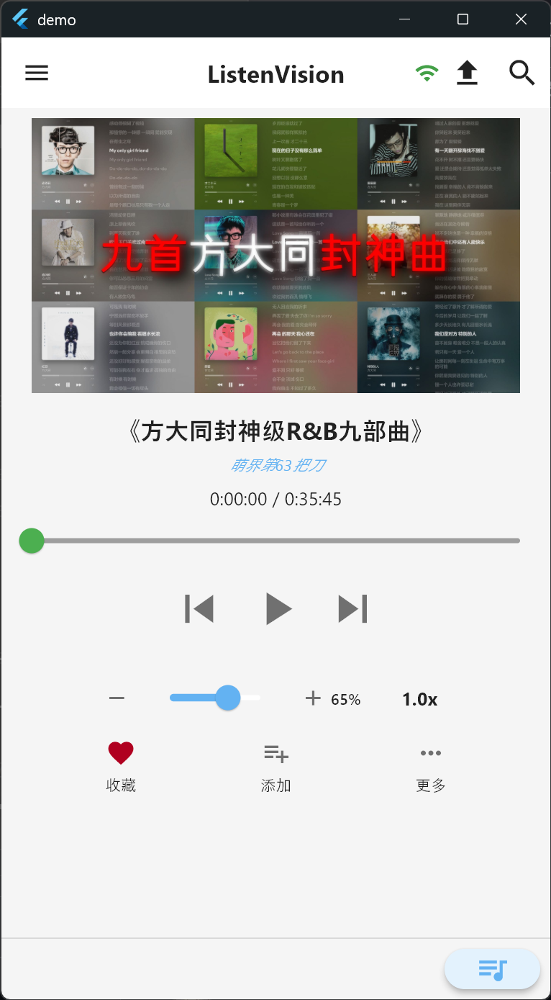
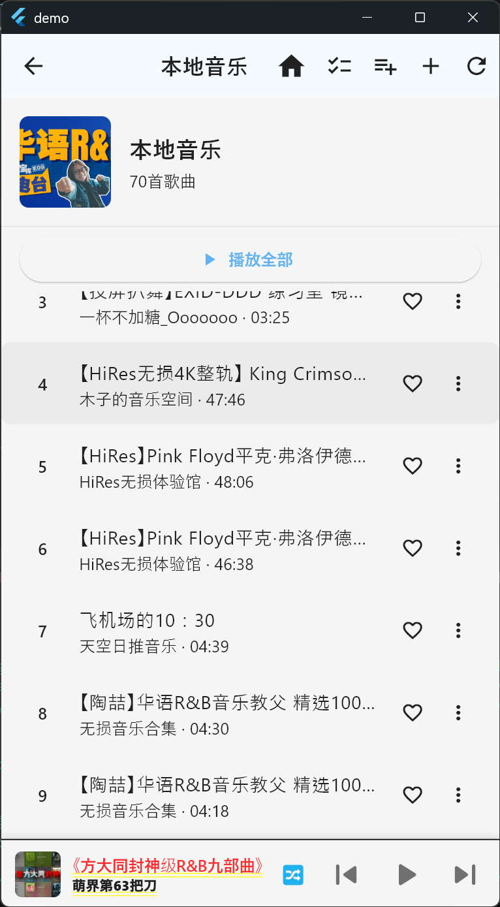
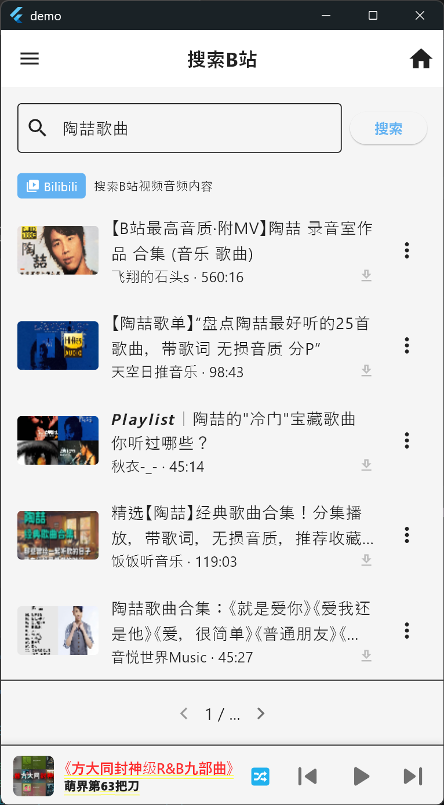

# ListenVision

从 B 站获取音频内容并播放。音乐、翻唱、相声评书、播客电台、ASMR、白噪音……搜索即播，也可以下载到本地离线收听。

> 纯本地应用，无需注册，也没有服务器。支持 Android 与 Windows；Web 版功能受限。当前源码版本以 `frontend_flutter/pubspec.yaml` 为准（0.1.0+1）。

<div align="center">
  
  
  
</div>

## 功能

### 搜索与发现

- 输入关键词搜索 B 站音频，支持搜索建议和分页加载。
- 搜索结果可直接播放、收藏、添加到歌单或加入下载队列。
- 多 P 视频按选集拆分，可选择任意一 P 单独播放。
- 发现页浏览 B 站推荐内容，支持下拉刷新和继续加载。
- 一键跳转到 B 站原视频页面。

### 播放

- 直接播放 B 站音频流，无需先下载。
- Android 支持后台播放、锁屏与通知栏媒体控制，拔出耳机自动暂停。
- 完整播放控制：拖动进度、上一首 / 下一首、音量调节，以及 0.5x–2.0x 倍速。
- 顺序播放、列表循环、随机播放、单曲循环四种播放模式。
- 播放队列支持定位当前曲目和一键清空。
- 离开首页后底部保留浮动播放条，点击可展开完整播放面板。
- 播放失败时给出提示，可直接重试。

### 下载与离线

- 下载队列展示进度和任务状态，支持暂停、继续、删除和失败重试。
- 最多同时下载 3 个任务，其余任务自动排队。
- 基于 CDN 响应校验的断点续传：中断或暂停后可从已完成部分继续。
- Android 保存 M4A 原始音频；Windows 等桌面端安装 FFmpeg 后可选择转为 MP3。
- 可选择是否同时下载封面。
- 下载页可查看任务状态和文件保存位置。
- 多 P 视频支持「下载全部」。

### 本地音乐

- 导入单个或多个本地音频文件，支持 MP3、M4A、FLAC、WAV、OGG。
- 自动读取标题、艺术家、专辑和封面信息。
- 扫描设备中的音频文件，统一加入「本地音乐」。
- 支持批量选择和移除；移除只影响应用内列表，不会删除原始文件。

### 歌单、收藏与历史

- 创建、编辑、删除歌单，填写名称与描述。
- 将歌曲添加到歌单，支持批量移除歌单内的曲目。
- 「我喜欢」是默认收藏歌单，点击心形图标即可收藏。
- 自动记录播放历史，支持清空历史记录。

### 设置与维护

- 浅色 / 深色主题切换。
- 下载格式与下载封面开关。
- 启动时自动扫描下载目录，标记被外部删除的文件，并定期复查。
- Android 端下载和扫描文件时按需申请权限。

## 安装与部署

### Android

1. 打开 [Releases](https://github.com/plankton12138/ListenVision_app/releases) 下载最新 APK。
2. 在手机上允许安装未知来源应用后安装，要求 Android 7.0 及以上。

> 当前安装包沿用开发签名，正式分发前需要配置生产签名。

### Windows

Releases 中暂未提供与当前源码版本对应的 Windows 安装包，可按下面的「从源码构建」步骤生成。

### Web

Web 版可以构建为静态站点部署，但浏览器无法访问本地文件系统，下载、后台播放和本地文件扫描不可用；受浏览器跨域策略影响，部分在线功能也可能受限。完整体验建议使用 Android 或 Windows 桌面版。

### 从源码构建

环境要求：

- Flutter 3.41 及以上（Dart 3.11 及以上）。
- 可选：安装 FFmpeg 并确保命令行可调用，用于桌面端格式转换。

```bash
git clone https://github.com/plankton12138/ListenVision_app.git
cd ListenVision_app/frontend_flutter

flutter pub get
flutter run          # 连接设备或模拟器后启动

# 构建
flutter build apk --release --split-per-abi   # Android，按 CPU 架构拆包
flutter build windows                         # Windows
flutter build web                             # Web 静态资源，输出到 build/web
```

## 使用须知

- B 站的反爬机制可能影响音频流获取，播放失败可以稍后重试。
- 下载的音频仅供个人使用，请遵守 B 站用户协议和版权法规。
- 桌面端音频格式转换需要系统已安装 FFmpeg 并能在命令行调用。
- Android 系统回收进程后需要重新打开应用恢复播放队列；不能保证强制停止后持续播放。锁屏连续播放和不同厂商的电量策略建议在真机上验收。
- 文件访问权限在下载或扫描操作时请求，启动时不会要求用户授予所有文件管理权限。

## 开源协议

本项目使用 [MIT License](LICENSE) 开源，Copyright (c) 2026 plankton12138。
