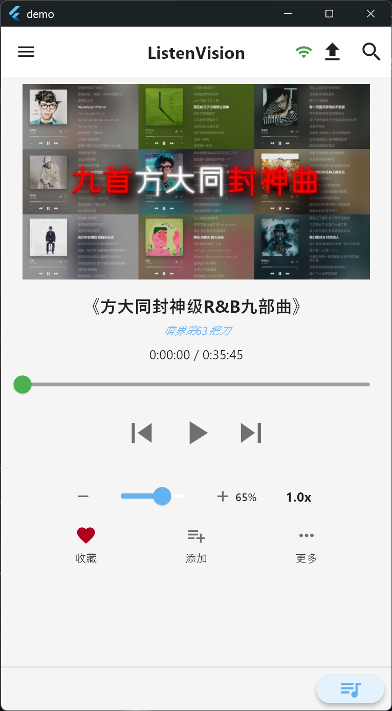
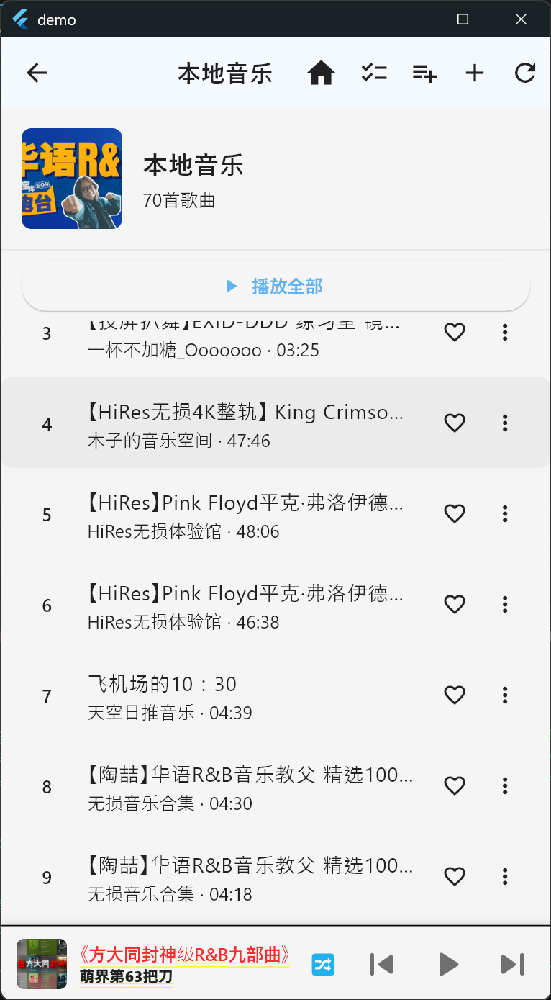
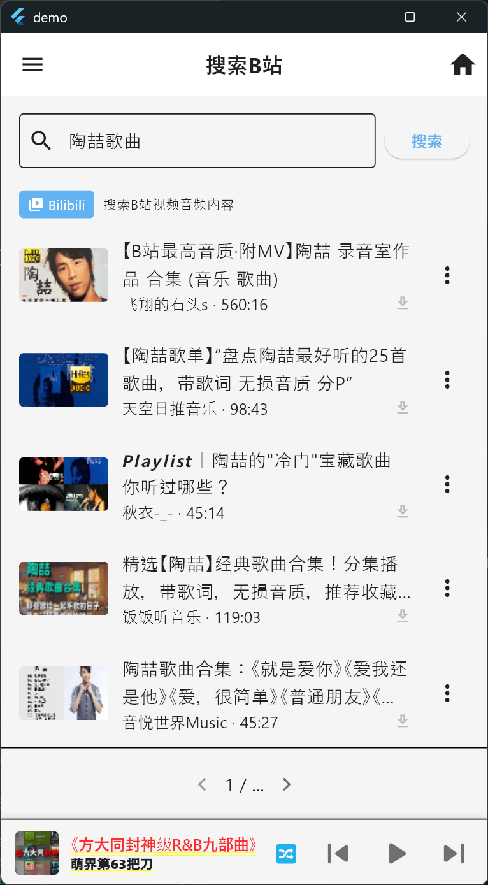

# ListenVision

直接从 Bilibili 获取音频内容并播放。无论是音乐、相声、播客、ASMR 还是其他音频内容，搜索即播，也可以下载到本地离线收听。

> 纯前端应用，无需服务器。Flutter 构建，Android / Windows 平台支持。

<div align="center">
  
  
  
</div>

## 核心功能

B站有丰富的音频内容：音乐、翻唱、相声评书、播客电台、ASMR、白噪音等，但官方客户端必须保持视频画面开启。ListenVision 只获取 DASH 音频流，支持后台播放和锁屏收听。

**搜索与播放。** 输入关键词搜索 B站，点击结果直接在线播放。多P视频和章节视频可以切换不同分段，提取对应音频。

**下载与格式转换。** 支持将音频下载到本地，可选 M4A、MP3 格式。安装 FFmpeg 后可在下载时自动转换格式。

**本地音频导入。** 设备上的音频文件可以导入应用，自动提取封面、标题、艺术家等元数据。

**歌单与收藏。** 创建歌单、添加曲目、拖拽排序。"我喜欢"为默认收藏歌单，点击心形图标即可收藏。播放历史自动记录。

**浮动播放条。** 离开首页后，底部显示当前播放信息和基本控制，点击展开完整面板。

**其他。** 启动时自动扫描下载目录，标记被外部删除的文件。支持浅色/深色主题切换。

## 技术概况

| 层面 | 选型 |
|------|------|
| 框架 | Flutter 3.41，Dart 3.11 |
| 音频播放 | media_kit（底层 libmpv），支持自定义 HTTP 请求头 |
| 状态管理 | Riverpod 3，配合 Freezed 代码生成 |
| 本地数据库 | SQLite（sqflite），存储歌单、历史、下载记录 |
| 网络请求 | Dio，直连 B站 REST API |
| 音频转换 | FFmpeg（桌面端调用系统 ffmpeg，移动端使用 ffmpeg_kit） |
| 路由 | go_router |
| 元数据 | audio_metadata_reader（读取）+ metadata_god（写入） |

项目结构遵循 MVVM 分层：`models`（数据模型）→ `data`（数据库和仓库）→ `services`（业务逻辑和第三方封装）→ `presentation`（ViewModel + View）。

## 开发环境

```bash
# 必备
Flutter SDK >= 3.41
Dart SDK >= 3.11

# 可选（音频格式转换需要）
FFmpeg（命令行可调用即可）
```

```bash
git clone https://github.com/plankton12138/listen-vision-audio-app.git
cd listen-vision-audio-app/frontend_flutter

flutter pub get
flutter run         # 连接设备或模拟器后启动

# 构建
flutter build apk   # Android
flutter build windows  # Windows
flutter build web   # Web（部分功能受限，见下文）
```

**Web 平台的限制：** 浏览器无法写入本地文件系统，所以下载、后台播放、本地文件扫描在 Web 版都不可用。完整体验建议使用 Android 或 Windows 桌面版。

## 项目结构

```
frontend_flutter/lib/
├── main.dart                    # 应用入口，初始化顺序
├── app.dart                     # MaterialApp.router 配置
├── core/                        # 基础设施（常量、网络、存储、工具）
│   ├── constants/               # UI 和 API 常量
│   ├── network/                 # Dio 实例和网络状态监听
│   ├── storage/                 # 共享存储服务
│   └── utils/                   # 日志、权限、图片等工具
├── models/                      # 数据模型（Audio, Playlist, PlayQueue 等）
│   └── dto/                     # API 响应 DTO
├── data/                        # 数据层
│   ├── database/                # DAO（TrackDao, PlaylistDao, PlayHistoryDao 等）
│   └── repositories/            # 仓库层（封装 DAO 操作）
├── services/                    # 服务层
│   ├── audio_player_service.dart    # 播放器封装（media_kit）
│   ├── bilibili_api_service.dart    # B站 API 直连
│   ├── bilibili_downloader.dart     # B站 音频下载
│   ├── download_service.dart        # 通用下载
│   ├── download_integrity_service.dart  # 文件完整性检查
│   ├── ffmpeg_service.dart          # 音频格式转换
│   ├── metadata_service.dart        # 元数据读取
│   └── platform/                    # 平台相关（媒体扫描）
└── presentation/                # 表现层
    ├── routes/router.dart           # 路由配置（go_router）
    ├── theme/                       # 浅色/深色主题
    ├── viewmodels/                  # ViewModel（Riverpod Notifier）
    │   ├── discovery/               # 搜索、发现
    │   ├── library/                 # 歌单、历史、本地音乐
    │   ├── player/                  # 播放器、队列、元数据
    │   ├── settings/                # 扫描设置
    │   └── system/                  # 主题、下载管理
    ├── views/                       # 页面
    │   ├── player/                  # 首页播放器、播放列表
    │   ├── discovery/               # 搜索、发现
    │   ├── library/                 # 歌单库、歌单详情、本地音乐、历史
    │   └── system/                  # 下载管理、设置
    └── widgets/                     # 可复用组件
        ├── player/                  # 浮动播放条、展开面板、控制按钮
        ├── audio/                   # 音频操作菜单
        └── common/                  # 通用组件（网络状态、SnackBar 等）
```

## 注意事项

- B站 的反爬机制可能会影响音频流获取，如果播放失败可以稍后重试
- 下载的音频仅供个人使用，请遵守 B站 用户协议和版权法规
- 桌面版音频转换需要系统已安装 FFmpeg 并可在命令行调用
