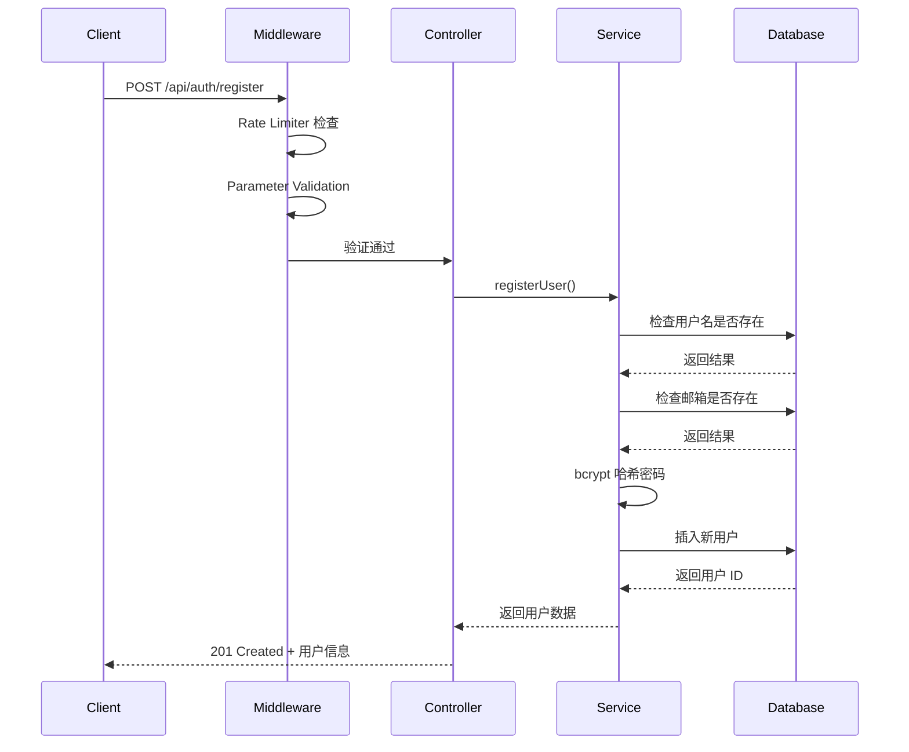

# ListenVision API Server

> ListenVision 应用的后端 API 服务 - 基于 Node.js + Express + MySQL 构建的现代化 RESTful API

## 📋 项目概述

ListenVision API 是一个为音频流媒体应用设计的后端服务，采用分层架构设计，提供完整的用户认证、数据管理和 API 文档功能。

### 当前状态

**✅ 已完成模块**（生产就绪）
- 用户认证系统（注册、登录、JWT）
- 用户管理（增删改查）
- 收藏管理
- 密码重置功能
- API 文档（Swagger）

**🚧 待开发模块**（核心业务功能）
- 音频文件管理（上传、下载、流式传输）
- B站 API 集成
- 搜索功能
- 播放列表管理
- 下载任务管理

---

## 🛠️ 技术栈

| 类别 | 技术 | 版本 | 用途 |
|------|------|------|------|
| **运行环境** | Node.js | 25.2.1 | JavaScript 运行时 |
| **Web 框架** | Express | 5.1.0 | HTTP 服务器框架 |
| **数据库** | MySQL | 8.0+ | 关系型数据库 |
| **数据库驱动** | mysql2 | 3.14.1 | MySQL 客户端（支持 Promise） |
| **认证** | JWT | 9.0.3 | JSON Web Token 身份验证 |
| **密码加密** | bcryptjs | 3.0.2 | 密码哈希 |
| **参数验证** | express-validator | 7.3.1 | 请求参数验证 |
| **限流** | express-rate-limit | 8.2.1 | API 请求限流 |
| **日志** | Winston | 3.19.0 | 日志管理系统 |
| **API 文档** | Swagger UI | 5.0.1 | 交互式 API 文档 |
| **CORS** | cors | 2.8.5 | 跨域资源共享 |

---

## 📁 项目结构

```
listen-vision_api/
├── config/                    # 配置文件
│   ├── database.js           # MySQL 数据库连接池配置
│   ├── jwt.js                # JWT Token 生成和验证
│   └── swagger.js            # Swagger API 文档配置
│
├── middleware/                # 中间件
│   ├── auth.js               # JWT 认证中间件
│   ├── errorHandler.js       # 统一错误处理
│   ├── rateLimiter.js        # 请求限流策略
│   └── validator.js          # 请求验证中间件
│
├── routes/                    # 路由定义
│   ├── auth.js               # 认证相关路由
│   ├── users.js              # 用户管理路由
│   └── favorites.js          # 收藏管理路由
│
├── controllers/               # 控制器（业务逻辑入口）
│   ├── authController.js     # 认证控制器
│   ├── userController.js     # 用户控制器
│   └── favoriteController.js # 收藏控制器
│
├── services/                  # 服务层（核心业务逻辑）
│   ├── userService.js        # 用户服务
│   ├── emailService.js       # 邮件服务
│   └── favoriteService.js    # 收藏服务
│
├── utils/                     # 工具函数
│   ├── logger.js             # Winston 日志配置
│   └── response.js           # 统一响应格式
│
├── logs/                      # 日志文件目录（自动创建）
│   ├── error.log             # 错误日志
│   ├── combined.log          # 所有日志
│   └── http.log              # HTTP 请求日志（生产环境）
│
├── .env                       # 环境变量配置（需手动创建）
├── .env.example               # 环境变量模板
├── index.js                   # 应用入口文件
├── package.json               # 项目依赖配置
└── CHANGELOG.md               # 项目更新日志
```

---

## 🏗️ 架构设计

### 分层架构

项目采用经典的四层架构，确保代码的可维护性和可扩展性：

```
┌─────────────────────────────────────────┐
│         Client (HTTP Client)            │
└──────────────────┬──────────────────────┘
                   │ HTTP Request
                   ↓
┌─────────────────────────────────────────────┐
│  Middleware Layer (中间件层)                 │
│  1. CORS                                    │
│  2. JSON Body Parser                        │
│  3. Request Logger (Winston)                │
│  4. Rate Limiter (express-rate-limit)       │
│  5. Parameter Validator (express-validator) │
│  6. JWT Authentication                     │
└──────────────────┬──────────────────────────┘
                   │ Validated Request
                   ↓
┌─────────────────────────────────────────────┐
│  Routes Layer (路由层)                       │
│  - 定义 API 端点                             │
│  - 映射到对应的控制器                         │
└──────────────────┬──────────────────────────┘
                   │ Route Handler Call
                   ↓
┌─────────────────────────────────────────────┐
│  Controllers Layer (控制器层)                 │
│  - 处理 HTTP 请求/响应                        │
│  - 调用服务层处理业务逻辑                     │
└──────────────────┬──────────────────────────┘
                   │ Business Logic Call
                   ↓
┌─────────────────────────────────────────────┐
│  Services Layer (服务层)                      │
│  - 实现核心业务逻辑                           │
│  - 数据库操作                                 │
│  - 外部服务调用                               │
└──────────────────┬──────────────────────────┘
                   │ SQL Query
                   ↓
┌─────────────────────────────────────────────┐
│  Database Layer (数据层)                      │
│  - MySQL Connection Pool                     │
│  - Data Persistence                          │
└─────────────────────────────────────────────┘
```

### 数据流示例

**用户注册流程：**



---

## 🚀 快速开始

### 环境要求

- **Node.js** >= 18.0.0
- **MySQL** >= 8.0
- **npm** 或 **yarn**

### 1. 安装依赖

```bash
cd listen-vision_api
npm install
```

### 2. 配置环境变量

复制环境变量模板并编辑：

```bash
cp .env.example .env
```

编辑 `.env` 文件：

```env
# 数据库配置
DB_HOST=127.0.0.1
DB_PORT=3306
DB_USER=plankton
DB_PASSWORD=your_password_here
DB_NAME=listenvision_app

# JWT 配置
JWT_SECRET=your_secret_key_here_change_in_production
JWT_EXPIRES_IN=7d

# 邮件服务配置（可选）
SMTP_HOST=smtp.qq.com
SMTP_PORT=465
SMTP_SECURE=true
SMTP_USER=your_email@qq.com
SMTP_PASS=your_smtp_password

# 服务器配置
PORT=3000
NODE_ENV=development
```

### 3. 创建数据库

使用 MySQL 客户端连接并创建数据库：

```sql
-- 连接到 MySQL
mysql -u root -p

-- 创建数据库
CREATE DATABASE IF NOT EXISTS listenvision_app;

-- 创建用户（如果需要）
CREATE USER IF NOT EXISTS 'plankton'@'localhost' IDENTIFIED BY 'plankton';
GRANT ALL PRIVILEGES ON listenvision_app.* TO 'plankton'@'localhost';
FLUSH PRIVILEGES;

-- 使用数据库
USE listenvision_app;

-- 创建用户表
CREATE TABLE IF NOT EXISTS users (
  id INT AUTO_INCREMENT PRIMARY KEY,
  username VARCHAR(20) UNIQUE NOT NULL,
  email VARCHAR(100) UNIQUE NOT NULL,
  password VARCHAR(255) NOT NULL,
  reset_code VARCHAR(6),
  code_expire DATETIME,
  created_at TIMESTAMP DEFAULT CURRENT_TIMESTAMP
) ENGINE=InnoDB DEFAULT CHARSET=utf8mb4;

-- 创建收藏表
CREATE TABLE IF NOT EXISTS favorites (
  id INT AUTO_INCREMENT PRIMARY KEY,
  url VARCHAR(2048) NOT NULL,
  title VARCHAR(255) NOT NULL,
  username VARCHAR(20) NOT NULL,
  created_at TIMESTAMP DEFAULT CURRENT_TIMESTAMP
) ENGINE=InnoDB DEFAULT CHARSET=utf8mb4;
```

### 4. 启动服务器

```bash
# 开发环境（带日志）
node index.js

# 或者使用 PM2（生产环境推荐）
pm2 start index.js --name listenvision-api
```

启动成功后会看到：

```
╔══════════════════════════════════════════════╗
║   ListenVision API Server                    ║
╠══════════════════════════════════════════════╣
║   Status: ✅ Running                          ║
║   Port: 3000                                ║
║   Env: development                           ║
║   Time: 2026/1/12 21:06:45                   ║
╠══════════════════════════════════════════════╣
║   API 文档: http://localhost:3000/api-docs    ║
║   健康检查: http://localhost:3000/health       ║
╚══════════════════════════════════════════════╝

✅ 数据库连接成功
```

### 5. 访问 API 文档

在浏览器中打开 Swagger UI：

```
http://localhost:3000/api-docs
```

---

## 📖 API 使用指南

### 通用响应格式

**成功响应：**
```json
{
  "success": true,
  "message": "操作成功",
  "data": { ... }
}
```

**错误响应：**
```json
{
  "success": false,
  "error": "错误信息描述"
}
```

### 核心 API 端点

#### 1. 健康检查

```bash
curl http://localhost:3000/health
```

#### 2. 用户注册

```bash
curl -X POST http://localhost:3000/api/auth/register \
  -H "Content-Type: application/json" \
  -d '{
    "username": "testuser",
    "email": "test@example.com",
    "password": "test123"
  }'
```

#### 3. 用户登录

```bash
curl -X POST http://localhost:3000/api/auth/login \
  -H "Content-Type: application/json" \
  -d '{
    "username": "testuser",
    "password": "test123"
  }'
```

**响应示例：**
```json
{
  "success": true,
  "message": "登录成功",
  "data": {
    "token": "eyJhbGciOiJIUzI1NiIsInR5cCI6IkpXVCJ9...",
    "user": {
      "id": 1,
      "username": "testuser",
      "email": "test@example.com"
    }
  }
}
```

#### 4. 获取当前用户信息（需要认证）

```bash
curl http://localhost:3000/api/auth/me \
  -H "Authorization: Bearer YOUR_TOKEN_HERE"
```

#### 5. 添加收藏（需要认证）

```bash
curl -X POST http://localhost:3000/api/favorites \
  -H "Content-Type: application/json" \
  -H "Authorization: Bearer YOUR_TOKEN_HERE" \
  -d '{
    "url": "https://example.com/audio.mp3",
    "title": "测试音频"
  }'
```

#### 6. 获取收藏列表

```bash
# 未登录：获取所有收藏
curl http://localhost:3000/api/favorites

# 已登录：只获取自己的收藏
curl http://localhost:3000/api/favorites \
  -H "Authorization: Bearer YOUR_TOKEN_HERE"
```

### 完整 API 文档

访问 Swagger UI 查看所有 API 端点和交互式测试：
```
http://localhost:3000/api-docs
```

---

## 🔒 安全特性

### 1. 密码安全

- 使用 **bcryptjs** 进行密码哈希（10 轮加密）
- 密码长度要求：至少 6 位，必须包含字母和数字
- 数据库中不存储明文密码

### 2. JWT 认证

- Token 有效期：7 天（可配置）
- Token 包含用户 ID 和用户名
- 请求受保护资源时需在 Header 中携带 Token：
  ```
  Authorization: Bearer <token>
  ```

### 3. 请求限流

| 限流类型 | 限制 | 适用端点 |
|---------|------|---------|
| 通用限流 | 每小时 100 次 | 所有 API |
| 登录限流 | 每 15 分钟 5 次 | `/api/auth/login` |
| 注册限流 | 每天 3 次 | `/api/auth/register` |
| 验证码限流 | 每 10 分钟 3 次 | `/api/auth/send-code` |

超过限制后返回：
```json
{
  "success": false,
  "error": "登录尝试次数过多，请 15 分钟后再试",
  "retryAfter": "15分钟"
}
```

### 4. 参数验证

使用 **express-validator** 自动验证所有输入参数：

- 用户名：3-20 个字符，仅字母数字下划线
- 邮箱：标准邮箱格式
- 密码：至少 6 位
- URL：有效的 URL 格式

### 5. 错误处理

- 统一的错误处理中间件
- 详细的错误日志记录
- 不向客户端暴露敏感信息（如堆栈跟踪）

---

## 📊 日志系统

### 日志文件

| 文件 | 内容 | 级别 |
|------|------|------|
| `logs/combined.log` | 所有日志 | info + error + warn |
| `logs/error.log` | 仅错误日志 | error |
| `logs/http.log` | HTTP 请求日志（生产环境） | http |

### 日志格式

```json
{
  "level": "info",
  "message": "Incoming request",
  "method": "POST",
  "url": "/api/auth/login",
  "ip": "::1",
  "userAgent": "curl/7.55.1",
  "service": "listen-vision-api",
  "timestamp": "2026-01-12 21:06:45"
}
```

### 查看日志

```bash
# 实时监控所有日志
tail -f logs/combined.log

# 查看错误日志
cat logs/error.log

# 搜索特定关键词
grep "ERROR" logs/combined.log
```

---

## 🚀 部署指南

### 生产环境配置

#### 1. 环境变量

```env
# 生产环境配置
NODE_ENV=production
PORT=3000

# 使用强密码
JWT_SECRET=use_a_very_long_random_string_here

# 数据库连接（建议使用连接池）
DB_HOST=your_production_db_host
DB_PORT=3306
DB_USER=production_user
DB_PASSWORD=strong_password_here
DB_NAME=listenvision_app
```

#### 2. 使用 PM2 部署（推荐）

**安装 PM2：**
```bash
npm install -g pm2
```

**启动服务：**
```bash
# 启动应用
pm2 start index.js --name listenvision-api

# 查看状态
pm2 status

# 查看日志
pm2 logs listenvision-api

# 设置开机自启
pm2 startup
pm2 save
```

**PM2 配置文件（`ecosystem.config.js`）：**
```javascript
module.exports = {
  apps: [{
    name: 'listenvision-api',
    script: 'index.js',
    instances: 'max', // 根据 CPU 核心数自动启动实例
    exec_mode: 'cluster',
    env: {
      NODE_ENV: 'production',
      PORT: 3000
    },
    error_file: './logs/pm2-error.log',
    out_file: './logs/pm2-out.log',
    log_date_format: 'YYYY-MM-DD HH:mm:ss Z',
    merge_logs: true,
    max_memory_restart: '500M'
  }]
};
```

使用配置文件启动：
```bash
pm2 start ecosystem.config.js
```

#### 3. Nginx 反向代理配置

**配置文件（`/etc/nginx/sites-available/listenvision-api`）：**
```nginx
server {
    listen 80;
    server_name api.listenvision.com;

    # 重定向到 HTTPS
    return 301 https://$server_name$request_uri;
}

server {
    listen 443 ssl http2;
    server_name api.listenvision.com;

    # SSL 证书配置
    ssl_certificate /path/to/your/certificate.crt;
    ssl_certificate_key /path/to/your/private.key;

    # SSL 安全配置
    ssl_protocols TLSv1.2 TLSv1.3;
    ssl_prefer_server_ciphers on;
    ssl_ciphers 'ECDHE-RSA-AES128-GCM-SHA256...';

    # 反向代理到 Node.js 应用
    location / {
        proxy_pass http://localhost:3000;
        proxy_http_version 1.1;
        proxy_set_header Upgrade $http_upgrade;
        proxy_set_header Connection 'upgrade';
        proxy_set_header Host $host;
        proxy_set_header X-Real-IP $remote_addr;
        proxy_set_header X-Forwarded-For $proxy_add_x_forwarded_for;
        proxy_set_header X-Forwarded-Proto $scheme;
        proxy_cache_bypass $http_upgrade;

        # 超时配置
        proxy_connect_timeout 60s;
        proxy_send_timeout 60s;
        proxy_read_timeout 60s;
    }

    # 限制请求体大小（用于文件上传）
    client_max_body_size 100M;
}
```

启用配置：
```bash
# 创建符号链接
sudo ln -s /etc/nginx/sites-available/listenvision-api /etc/nginx/sites-enabled/

# 测试配置
sudo nginx -t

# 重启 Nginx
sudo systemctl restart nginx
```

#### 4. Docker 部署

**Dockerfile：**
```dockerfile
FROM node:18-alpine

# 设置工作目录
WORKDIR /app

# 复制 package.json 和 package-lock.json
COPY package*.json ./

# 安装依赖
RUN npm ci --only=production

# 复制应用代码
COPY . .

# 创建日志目录
RUN mkdir -p logs

# 暴露端口
EXPOSE 3000

# 启动应用
CMD ["node", "index.js"]
```

**docker-compose.yml：**
```yaml
version: '3.8'

services:
  api:
    build: .
    ports:
      - "3000:3000"
    environment:
      - NODE_ENV=production
      - DB_HOST=mysql
      - DB_USER=root
      - DB_PASSWORD=password
      - DB_NAME=listenvision_app
    depends_on:
      - mysql
    restart: unless-stopped

  mysql:
    image: mysql:8.0
    environment:
      - MYSQL_ROOT_PASSWORD=password
      - MYSQL_DATABASE=listenvision_app
    volumes:
      - mysql_data:/var/lib/mysql
    restart: unless-stopped

volumes:
  mysql_data:
```

启动服务：
```bash
docker-compose up -d
```

#### 5. 健康检查和监控

**健康检查脚本（`healthcheck.sh`）：**
```bash
#!/bin/bash

HEALTH_URL="http://localhost:3000/health"
RESPONSE=$(curl -s $HEALTH_URL)

if echo $RESPONSE | grep -q '"success":true'; then
    echo "✅ API is healthy"
    exit 0
else
    echo "❌ API is unhealthy"
    exit 1
fi
```

**定时任务（crontab）：**
```bash
# 每 5 分钟检查一次健康状态
*/5 * * * * /path/to/healthcheck.sh
```

---

## 🧪 测试

### 手动测试

使用提供的 curl 命令或访问 Swagger UI 进行测试。

### 自动化测试（待实现）

当前项目未配置自动化测试框架。建议使用 **Jest** 或 **Mocha** 进行单元测试和集成测试。

---

## 📝 开发规范

### 代码风格

- 使用 **ESLint** 进行代码检查
- 使用 **Prettier** 进行代码格式化
- 遵循 Airbnb JavaScript 风格指南

### Git 工作流

```bash
# 创建功能分支
git checkout -b feature/your-feature-name

# 提交更改
git add .
git commit -m "feat: add your feature description"

# 推送到远程
git push origin feature/your-feature-name
```

### 提交信息规范

遵循 **Conventional Commits** 规范：

- `feat:` 新功能
- `fix:` Bug 修复
- `docs:` 文档更新
- `style:` 代码格式调整
- `refactor:` 代码重构
- `test:` 测试相关
- `chore:` 构建/工具链更新

---

## 📚 待开发功能

根据 ListenVision 音频应用的定位，以下功能需要继续开发：

### 高优先级 🔴

1. **音频文件管理**
   - 音频上传接口
   - 音频下载接口
   - 音频流式传输
   - 音频元数据管理

2. **B站 API 集成**
   - 视频信息获取
   - 音频提取
   - Cookie 管理
   - 登录状态维护

3. **搜索功能**
   - 音频搜索
   - 分类筛选
   - 热门推荐

4. **播放列表管理**
   - 创建/编辑/删除播放列表
   - 添加/移除音频
   - 播放列表排序

5. **下载任务管理**
   - 创建下载任务
   - 进度追踪
   - 暂停/恢复/取消

### 中优先级 🟡

1. **用户偏好设置**
   - 主题设置
   - 播放设置
   - 通知设置

2. **社交功能**
   - 用户关注
   - 内容分享
   - 评论系统

3. **数据分析**
   - 播放统计
   - 用户行为分析
   - 热门内容排行

### 低优先级 🟢

1. **高级功能**
   - 离线下载
   - 多设备同步
   - 家庭共享

---

## 🐛 常见问题

### Q1: 数据库连接失败

**错误信息：** `Access denied for user 'plankton'@'localhost'`

**解决方案：**
1. 检查 `.env` 文件中的数据库配置
2. 确认 MySQL 服务正在运行
3. 确认用户已创建并授予权限

### Q2: JWT Token 验证失败

**错误信息：** `Token 无效`

**解决方案：**
1. 检查 Token 是否过期
2. 确认请求头格式正确：`Authorization: Bearer <token>`
3. 检查 `JWT_SECRET` 是否一致

### Q3: 端口被占用

**错误信息：** `Error: listen EADDRINUSE: address already in use :::3000`

**解决方案：**
```bash
# Windows
netstat -ano | findstr :3000
taskkill /PID <PID> /F

# Linux/Mac
lsof -ti:3000 | xargs kill -9
```

### Q4: 限流过于严格

**解决方案：**
编辑 `middleware/rateLimiter.js`，调整限流参数：
```javascript
const loginLimiter = rateLimit({
  windowMs: 15 * 60 * 1000, // 时间窗口
  max: 5,                    // 最大请求次数
  message: '登录尝试次数过多，请 15 分钟后再试'
});
```

---

## 📄 许可证

ISC License

---

## 👥 贡献

欢迎提交 Issue 和 Pull Request！

---

## 📞 联系方式

如有问题，请提交 Issue 或联系项目维护者。

---

**最后更新：** 2026-01-12
**文档版本：** 1.0.0
